<div align="center">

# ETCAD

**Claude legge, modifica e disegna schemi elettrici DWG, dal vivo, accanto a te.**

Un server [MCP](https://modelcontextprotocol.io) per schemi e schede cavi DWG/DXF: legge, modifica e crea DWG nativi
senza un CAD installato, converte i PDF in DWG con testi veri e modificabili, e ha una vista dal vivo in stile
AutoCAD dove guardi Claude disegnare, ci parli in chat e disegni anche tu.


[English](README.md) · [Italiano](README.it.md)

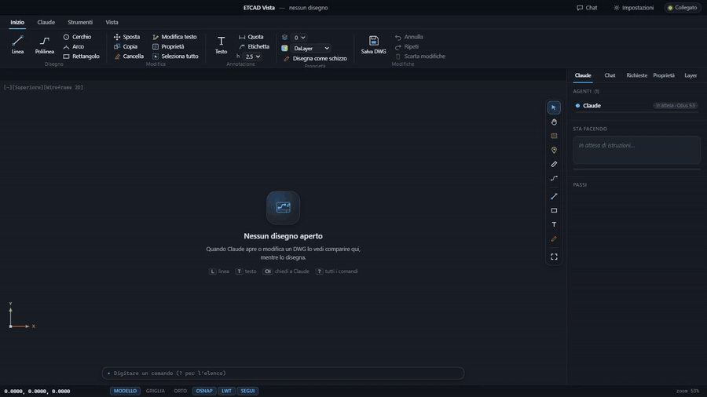

*Chiedi nella chat della vista, Claude fa una domanda e disegna la scheda del cavo passo per passo, poi ne cambia la
lunghezza. [Video completo (MP4, 72 s)](docs/media/demo.mp4)*

</div>

---

## Cosa fa

| | |
|---|---|
| 🖥️ **Vista dal vivo** | Una pagina locale in stile AutoCAD: vedi Claude disegnare passo per passo con il suo ragionamento, gli scrivi in chat **senza chiave API** (i messaggi arrivano alla tua sessione di Claude Code), gli indichi le zone, disegni e modifichi anche tu e salvi nel DWG. |
| 📄 **PDF → DWG** | I PDF vettoriali dove il testo è fatto di tratti di penna (i plot dei CAD con font SHX) diventano DWG con **entità TEXT vere**, il cartiglio come blocco con attributi e un rapporto da rivedere. |
| ✏️ **DWG senza CAD** | Legge, modifica e crea DWG nativi con `ezdxf` e l'ODA File Converter gratuito: modifiche in blocco, cerca e sostituisci (anche Ø ° ±), attributi del cartiglio, copia di zone fra disegni, backup automatici. |
| 🔌 **Strumenti per i cablaggi** | Segue un filo, rinumera fili e morsetti, cerca un testo in un'intera cartella di disegni, legge una tabella disegnata in Excel, confronta due DWG per contenuto, fa la distinta dei materiali dalle schede cavo, dimensiona i cavi e dà i colori dei fili (CEI EN 60204-1). |
| 📐 **Disegni nuovi da una specifica** | Una scheda cavo A3 completa in DWG da un breve JSON: connettori circolari (M8/M12/M23) o morsettiere, fili colorati, schermo, sezione, tabella dei pin, distinta, quota, cartiglio. |
| 🌍 **Quattro lingue** | La vista parla italiano, inglese, francese e spagnolo (selettore con le bandierine nella barra del titolo); i nomi dei comandi seguono AutoCAD nella lingua scelta (LINE, LIGNE, LÍNEA…) e tutti gli alias valgono in tutte le lingue. |
| 🤖 **Sottoagenti** | Claude divide il lavoro fra più agenti: ognuno ha la sua chat nella pagina, con **modello, effort e ragionamento**, e il suo riquadro. |
| 🏭 **SPAC Automazione CAD (facoltativo)** | Se c'è, anche `accoreconsole` senza interfaccia, il database della commessa e l'automazione COM dal vivo. Tutto il resto funziona senza. |

## I più usati

74 tool in tutto, [elenco completo](README.md#all-74-tools):

| Tool | Cosa fa |
|---|---|
| `vista_apri` · `vista_mostra` · `vista_pensa` | Apre la vista, ci mostra un DWG/DXF, scrive il ragionamento nella pagina |
| `vista_ascolta` · `vista_chat` · `vista_richieste` | Legge i tuoi messaggi e le zone che selezioni, e risponde lì |
| `pdf_a_dwg` | PDF vettoriale → DWG con testi veri, un DWG per pagina più tutti i fogli affiancati |
| `pdf_correggi` | Corregge i testi letti male; le correzioni restano e si riapplicano |
| `dwg_modifica` | Modifiche in blocco: testi, sposta, elimina, proprietà, layer, linee, polilinee, etichette, quote, blocchi |
| `dwg_sostituisci` | Cerca e sostituisci in un DWG o in una cartella (TEXT, MTEXT, attributi, definizioni dei blocchi) |
| `dwg_cartiglio` | Elenca o imposta gli attributi del cartiglio su tutti i fogli |
| `dwg_controlla` | Controllo grafico: testi sovrapposti, testi toccati da linee, doppioni |
| `dwg_traccia_fili` | Segue un filo da un punto: entità collegate, capi liberi e le scritte vicine |
| `dwg_confronta` | Cosa cambia davvero fra due DWG (o due cartelle), indipendentemente dagli handle |
| `cablaggio_distinta` | Distinta materiali dalle schede cavo (guaine, puntali, connettori, cavi, lunghezze), in Excel |
| `dwg_cerca` | Cerca un testo in tutti i DWG di una cartella: file, foglio, layer, handle e posizione di ogni risultato |
| `dwg_rinumera` | Rinumera fili, morsetti o pin in ordine di lettura, con lo stesso numero ai due capi di un filo |
| `scheda_cavo_crea` | Disegna in DWG una scheda cavo completa (o uno sdoppiatore, o uno schema ingressi) da una specifica JSON |

## La vista dal vivo

<table>
<tr>
<td width="50%">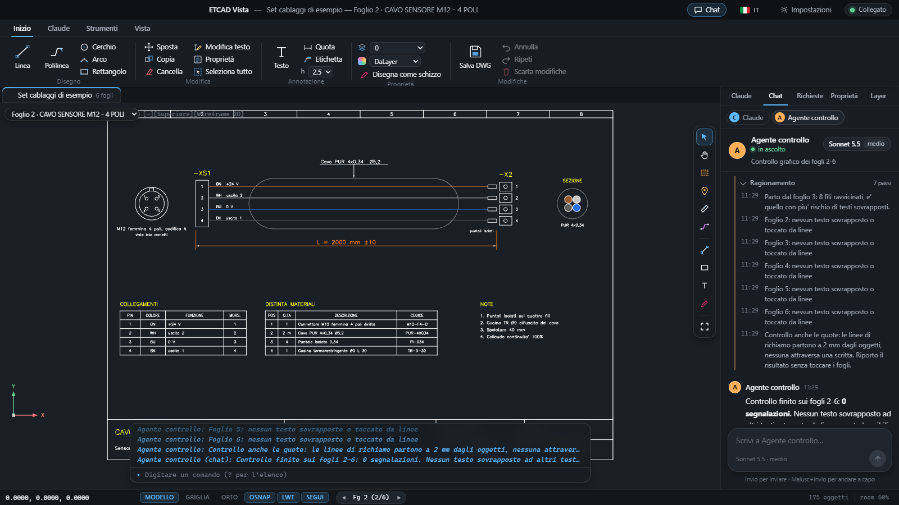<br><b>Sottoagenti</b>: il Claude principale apre un agente e ne sceglie modello ed effort; l'agente ha la sua chat con il ragionamento.</td>
<td width="50%">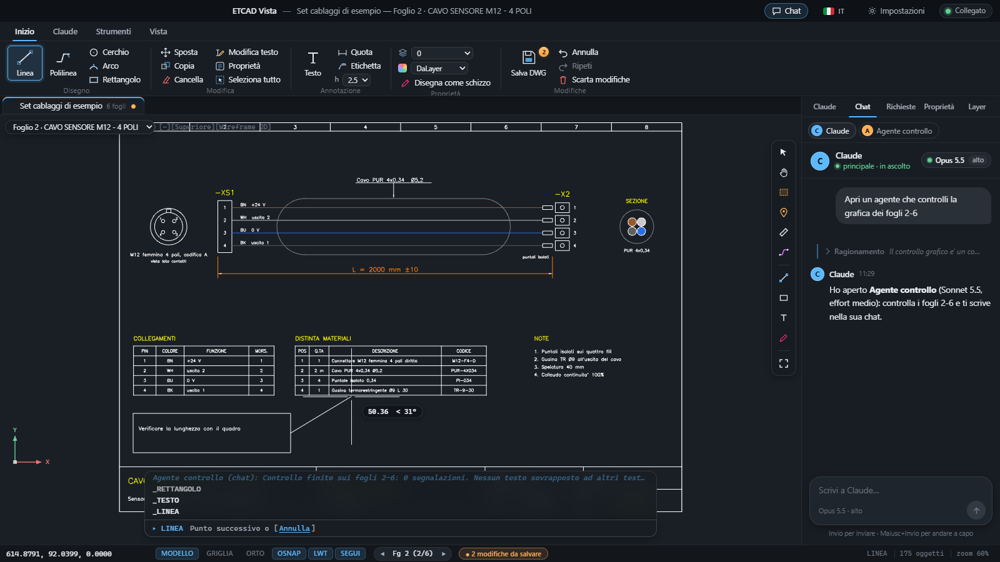<br><b>Disegni anche tu</b>: riga di comando con gli alias di AutoCAD, OSNAP, ORTO, input dinamico; le modifiche si salvano nel DWG.</td>
</tr>
<tr>
<td>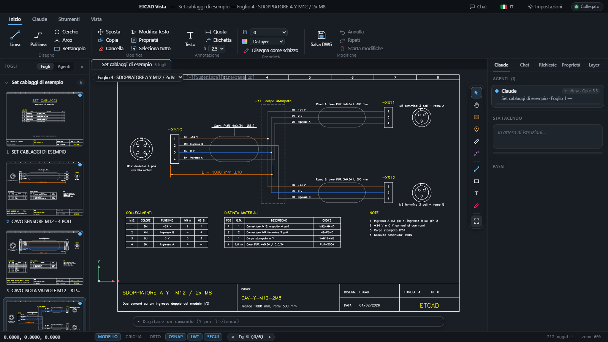<br><b>Multifogli</b>: fogli affiancati, multifogli SPAC (un layer per foglio) o layer numerati, con le miniature.</td>
<td>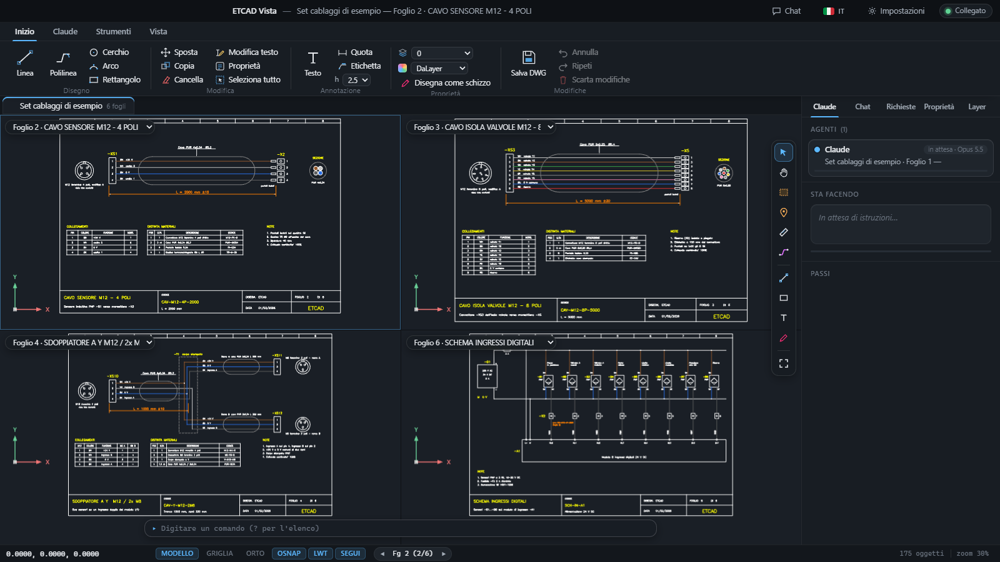<br><b>Più riquadri</b>: 1, 2 o 4, uno per foglio o uno per agente.</td>
</tr>
<tr>
<td>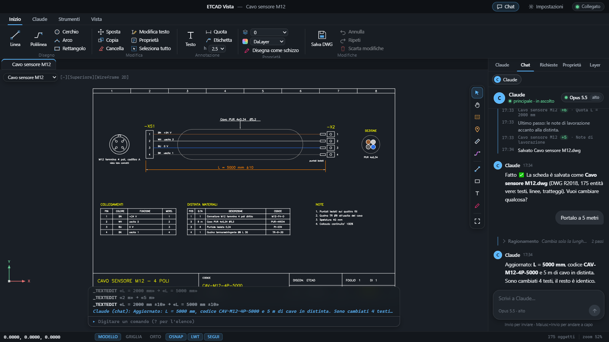<br><b>Chat come l'app di Claude</b>: markdown, ragionamento richiudibile, modello ed effort della tua sessione di Claude Code.</td>
<td>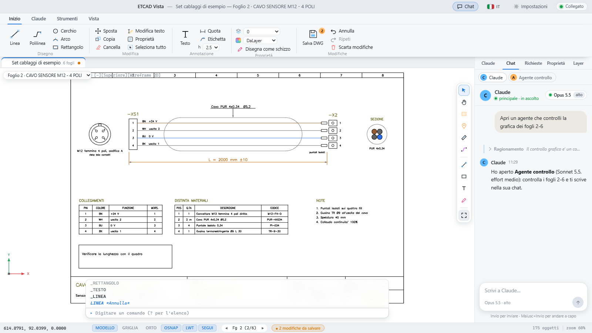<br><b>Tema chiaro e scuro</b>, PDF in sottofondo, layer, proprietà con l'handle del DWG, misure, ricerca.</td>
</tr>
</table>

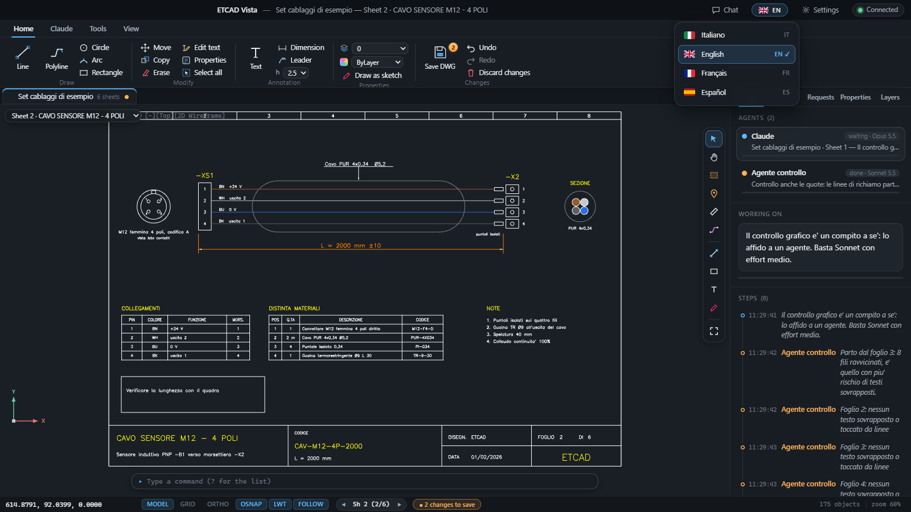

*La stessa pagina in inglese: scegli Italiano, English, Français o Español dalla bandierina nella barra del titolo.
La prima volta segue la lingua del browser; la scelta resta.*

Tutto gira su `127.0.0.1`: nessun servizio esterno, nessun caricamento.

**Comandi di disegno** (nella riga di comando valgono gli alias di AutoCAD e i nomi di tutte le lingue):
`LINEA` (L), `POLILINEA` (PL),
`RETTANGOLO` (REC), `CERCHIO` (C), `ARCO` (A), `TESTO` (T, DT), `QUOTA` (DIM), `ETICHETTA` (LE), `SPOSTA` (M),
`COPIA` (CO), `CANCELLA` (E), `MODTESTO` (ED), `PROPRIETA` (PR), `ANNULLA` (U), `RIPETI`, `SALVA` (Ctrl+S),
`DISTANZA` (DI), `AREA`, `ID`, `FILO` (segue un filo), `TROVA` (Ctrl+F), `ZOOM`, `PAN`, `ORTO` (F8), `OSNAP` (F3),
`GRIGLIA` (F7).
**Per Claude**: `CHIEDI` (selezioni un'area e chiedi), `NOTA` (nota su un punto), `MATITA` e `NUVOLA` (schizzo e
nuvola di revisione), `CHAT`.

## PDF → DWG

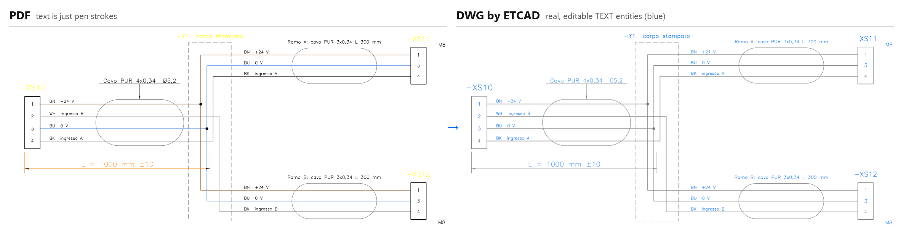

Molti CAD stampano i font SHX come segmenti, quindi nel PDF di un disegno non c'è testo. `pdf_a_dwg` raggruppa i
tratti in caratteri, impara i glifi del documento (un dizionario costruito con un OCR locale), ricostruisce spazi,
maiuscole, rotazioni e punti d'inserimento, trova la cornice ripetuta su ogni pagina e la trasforma in un blocco con
attributi.

Sul set d'esempio di questa repository (6 fogli A3 generati con ETCAD e stampati in PDF), senza nessuna correzione a
mano: **505 testi su 601 (84%) tornano identici** e le pagine si sovrappongono al PDF con somiglianza 0,96-0,98, in
30 secondi su un normale PC d'ufficio. Il resto è elencato nel rapporto e si sistema con `pdf_correggi`, che ricorda
le correzioni per la conversione successiva.

## Esempi

Tutti i disegni della repository sono inventati e generati da codice ([`examples/genera_esempi.py`](examples/genera_esempi.py)).

<table>
<tr>
<td><a href="examples/set_cablaggi/anteprime/foglio_2.png">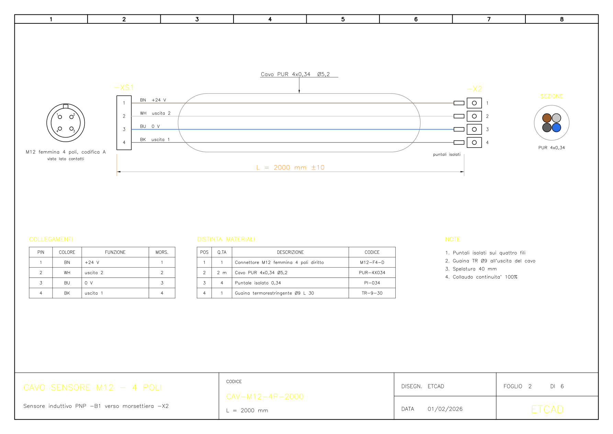</a><br>Cavo sensore M12 4 poli</td>
<td><a href="examples/set_cablaggi/anteprime/foglio_3.png">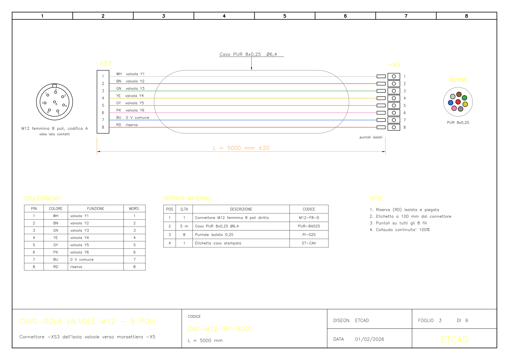</a><br>Cavo isola valvole M12 8 poli</td>
<td><a href="examples/set_cablaggi/anteprime/foglio_4.png">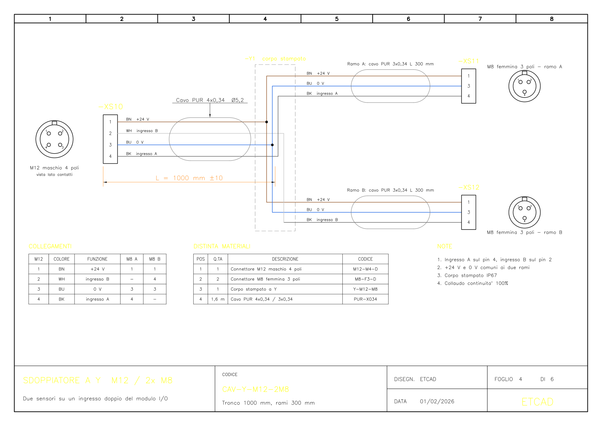</a><br>Sdoppiatore a Y M12 → 2× M8</td>
</tr>
<tr>
<td><a href="examples/set_cablaggi/anteprime/foglio_5.png">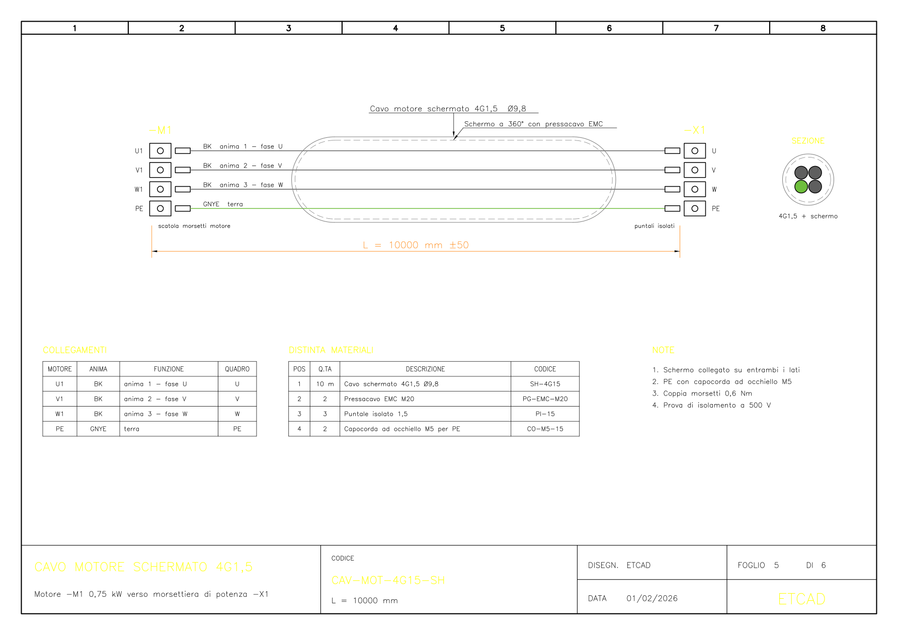</a><br>Cavo motore schermato 4G1,5</td>
<td><a href="examples/set_cablaggi/anteprime/foglio_6.png">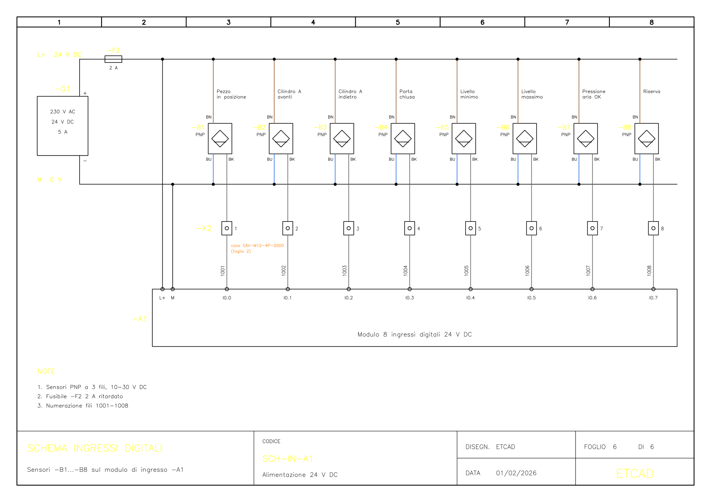</a><br>Schema ingressi digitali (PLC)</td>
<td><a href="examples/set_cablaggi/anteprime/foglio_1.png">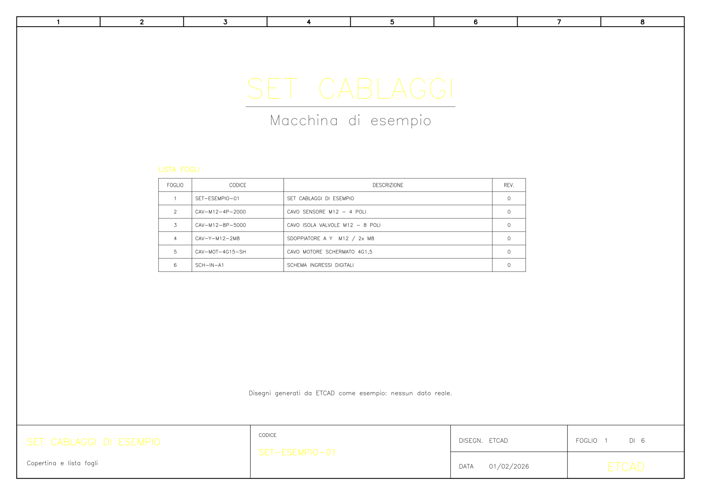</a><br>Copertina e lista fogli</td>
</tr>
</table>

- [`examples/set_cablaggi/`](examples/set_cablaggi): i 6 fogli in un DWG (cornice come blocco con attributi) e in
  PDF, l'ingresso per provare PDF → DWG.
- [`examples/cavo_m12/`](examples/cavo_m12): il foglio singolo della demo.
- [`examples/README.md`](examples/README.md): richieste da provare con questi file.

## Installazione

**Requisiti**

- Python 3.11+ (oppure [uv](https://docs.astral.sh/uv/)).
- [ODA File Converter](https://www.opendesign.com/guestfiles/oda_file_converter) (gratuito) per leggere e scrivere i
  DWG. ETCAD lo cerca nelle cartelle solite, oppure imposta `ODA_FILE_CONVERTER` con il percorso dell'eseguibile.
  Senza, ETCAD lavora sui DXF.
- Facoltativo: l'extra `ocr` (RapidOCR, locale) per PDF → DWG.

**Claude Code**

```bash
claude mcp add etcad -- uvx --from git+https://github.com/Samuk734/ETCAD --with rapidocr_onnxruntime etcad
```

oppure con pip:

```bash
pip install "etcad[ocr] @ git+https://github.com/Samuk734/ETCAD"
claude mcp add etcad -- etcad
```

**Claude Desktop** (`claude_desktop_config.json`)

```json
{
  "mcpServers": {
    "etcad": {
      "command": "uvx",
      "args": ["--from", "git+https://github.com/Samuk734/ETCAD", "--with", "rapidocr_onnxruntime", "etcad"]
    }
  }
}
```

Per controllare l'installazione chiedi a Claude di eseguire `spac_status`: riporta il convertitore DWG, l'OCR e, se
c'è, SPAC.

## Per iniziare

Chiedi a Claude, per esempio:

- *"Apri la vista e mostrami `examples/set_cablaggi/Set cablaggi di esempio.dwg`."*
- *"Converti `Set cablaggi di esempio.pdf` in DWG e dimmi di quali testi non sei sicuro."*
- *"Su tutti i fogli metti nel cartiglio la data 01/03/2026 e il disegnatore A.B."*
- *"Controlla che nel foglio 4 non ci siano testi sovrapposti e sistemali."*
- *"Segui il filo che parte dal pin 3 di -XS1 e dimmi dove arriva."*
- *"Fammi la distinta dei materiali di tutte le schede cavo di questa cartella, in Excel."*
- *"Apri due agenti: uno controlla i fogli 2-3, l'altro i fogli 4-6."*
- *"In quali disegni di questa cartella c'è la morsettiera -X2?"*
- *"Rinumera i fili del foglio 6 partendo da 2001."*
- *"Disegnami la scheda di un cavo encoder M23 a 8 poli, schermato, 5 m, verso la morsettiera -X20."*
- *"Leggi in Excel la tabella della distinta del foglio 3."*

### Lavorare nella vista

1. Claude apre la pagina con `vista_apri` (oppure lanci tu `etcad-vista`, che risponde su `http://127.0.0.1:8765`).
2. Ogni modifica fatta con i tool compare animata sul foglio, con il ragionamento.
3. Per parlare con Claude dalla pagina chiedigli di restare in ascolto: chiama `vista_ascolta` a ciclo (in Claude Code
   può anche tenere `etcad-vista ascolta --continuo` in background). Messaggi, zone e note arrivano alla sessione che
   sta lavorando, senza chiave API.
4. Puoi disegnare e modificare sul foglio; **Salva DWG** scrive le modifiche in una copia (`_modificato.dwg`) o sul
   file, con un backup.

Un consiglio per il tuo `CLAUDE.md`:

```markdown
Quando lavori sui DWG con ETCAD apri la vista (vista_apri), scrivi il ragionamento con vista_pensa, mostra ogni
modifica con vista_mostra e tieni vista_ascolta armato per leggere i miei messaggi dalla pagina.
```

## Sviluppo

```bash
git clone https://github.com/Samuk734/ETCAD && cd ETCAD
pip install -e ".[ocr,dev]"
python -m pytest tests -q            # i test che richiedono SPAC vengono saltati
python examples/genera_esempi.py     # rigenera i disegni d'esempio
python examples/video/registra_demo.py video   # registra di nuovo la demo (serve playwright e imageio-ffmpeg)
```

Sviluppato e provato su Windows 10 con Python 3.12. Il nucleo (ezdxf, PyMuPDF, shapely) è multipiattaforma; i tool
SPAC e COM funzionano solo su Windows. La vista è in italiano, inglese, francese e spagnolo (`etcad/vista/static/i18n.js`
e `i18n_testi.js`: le chiavi sono le frasi italiane, quindi per una lingua nuova basta un dizionario).

## Licenza

[MIT](LICENSE). Il font Hershey Roman Simplex in `etcad/dati` serve per le anteprime, secondo i termini originali
dei font Hershey.
