<div align="center">

# ETCAD

**Let Claude read, edit and draw electrical CAD drawings, live, next to you.**

An [MCP](https://modelcontextprotocol.io) server for DWG/DXF wiring diagrams and cable sheets: no CAD needed to read,
edit and create native DWG files, PDF → DWG with real, editable text, and an AutoCAD-style live view where you watch
Claude draw, chat with it and draw yourself.


[English](README.md) · [Italiano](README.it.md)

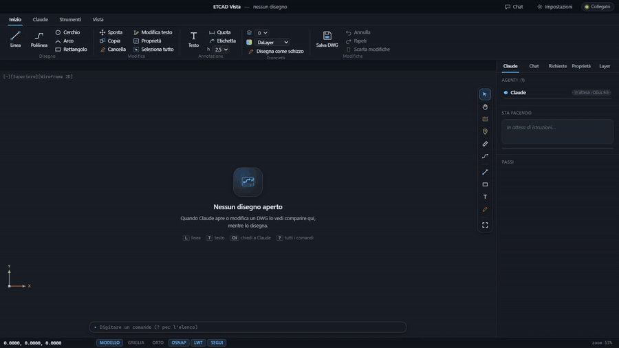

*You ask in the chat of the live view, Claude asks one question and draws the cable sheet step by step, then changes
its length on request. [Full video (MP4, 72 s)](docs/media/demo.mp4)*

</div>

---

## What it does

| | |
|---|---|
| 🖥️ **Live view** | A local AutoCAD-style page: watch Claude draw step by step with its reasoning, chat with it **without an API key** (messages go to your Claude Code session), point at areas, and draw and edit yourself, then save back to DWG. |
| 📄 **PDF → DWG** | Vector PDFs whose text is just pen strokes (typical CAD plots with SHX fonts) become DWGs with **real TEXT entities**, a title-block block with attributes, and a review report. |
| ✏️ **DWG without a CAD** | Read, edit and create native DWG files with `ezdxf` and the free ODA File Converter: batch edits, find & replace (Ø ° ± aware), title-block attributes, copying zones between drawings, automatic backups. |
| 🔌 **Wiring tools** | Follow a wire, find a free spot for a label, compare two DWGs by content, a bill of materials from cable sheets to Excel, cable sizing and wire colours (EN 60204-1). |
| 🤖 **Sub-agents** | Claude can split the work among agents: each one gets its own chat in the page, with **model, effort and its reasoning**, and its own pane. |
| 🏭 **SPAC Automazione CAD (optional)** | If present, also headless `accoreconsole`, the project database and live COM automation. Everything else works without it. |

## Highlights

The tools you will use most (66 in total, [full list below](#all-66-tools)):

| Tool | What it does |
|---|---|
| `vista_apri` · `vista_mostra` · `vista_pensa` | Open the live view, show a DWG/DXF in it, send the current reasoning to the page |
| `vista_ascolta` · `vista_chat` · `vista_richieste` | Read your messages and the areas you selected in the page, and answer there |
| `pdf_a_dwg` | Convert a vector PDF to DWG with real texts, one DWG per page plus all sheets side by side |
| `pdf_correggi` | Fix the few texts the recognizer got wrong; corrections are kept and re-applied |
| `dwg_modifica` | Batch edits on a DWG: texts, move, delete, properties, layers, lines, polylines, labels, dimensions, blocks |
| `dwg_sostituisci` | Find & replace in one DWG or a whole folder (TEXT, MTEXT, attributes, block definitions) |
| `dwg_cartiglio` | List or set title-block attributes on every sheet |
| `dwg_controlla` | Graphic check: overlapping texts, texts touched by lines, duplicates |
| `dwg_traccia_fili` | Follow a wire from a point: connected entities, free ends and the labels near them |
| `dwg_confronta` | What really changed between two DWGs (or two folders), independent of handles |
| `cablaggio_distinta` | Bill of materials (sleeves, ferrules, connectors, cables, lengths) from cable sheets, to Excel |

## The live view

<table>
<tr>
<td width="50%">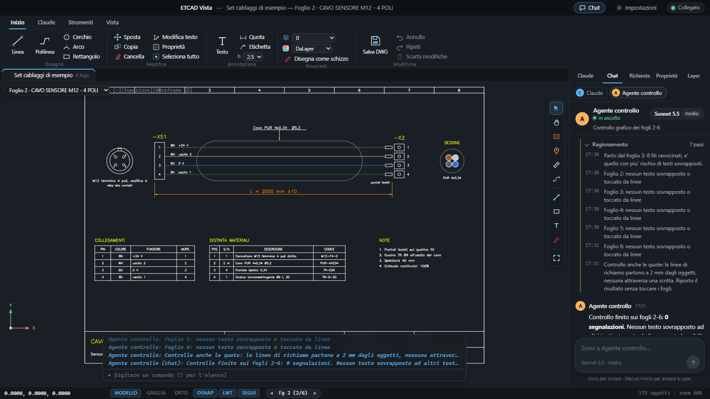<br><b>Sub-agents</b>: the main Claude opens an agent and picks its model and effort; the agent has its own chat with its reasoning.</td>
<td width="50%">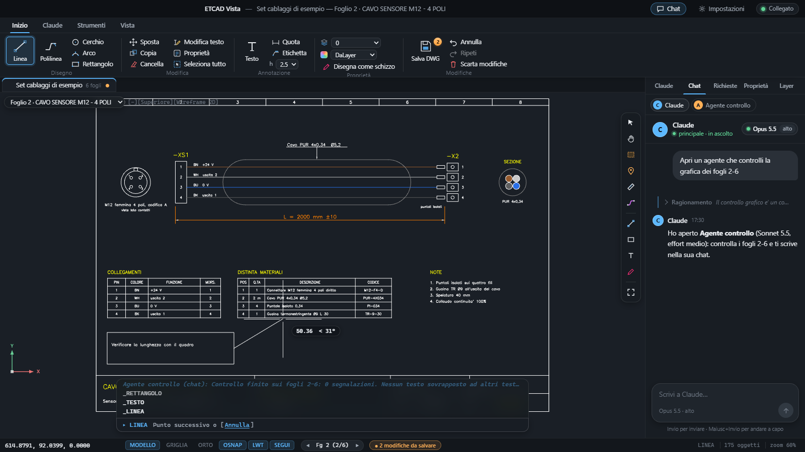<br><b>You draw too</b>: command line with AutoCAD aliases, OSNAP, ORTHO, dynamic input; your edits are saved to DWG.</td>
</tr>
<tr>
<td>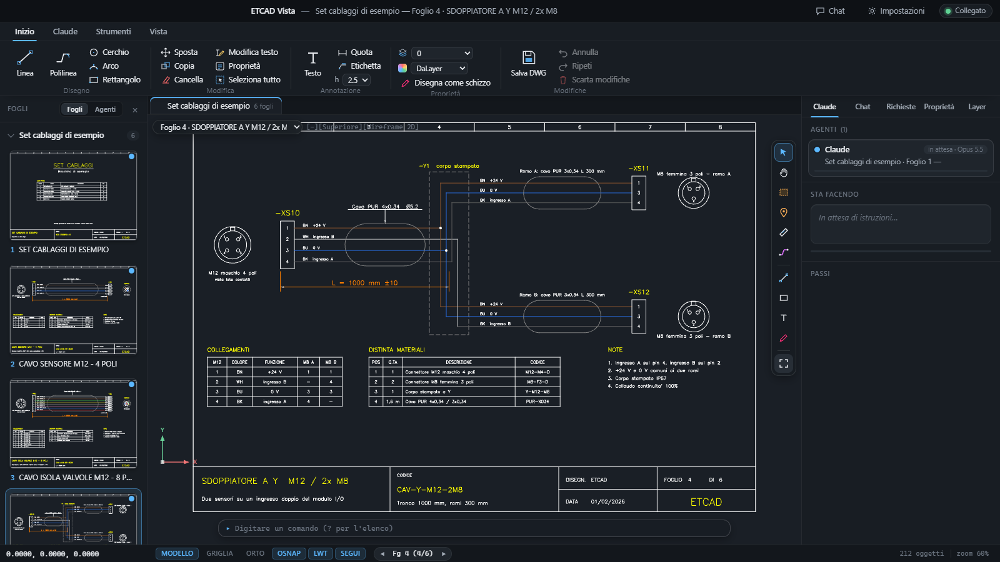<br><b>Multi-sheet drawings</b>: sheets side by side, SPAC multi-sheets (one layer per sheet) or numbered layers, with thumbnails.</td>
<td>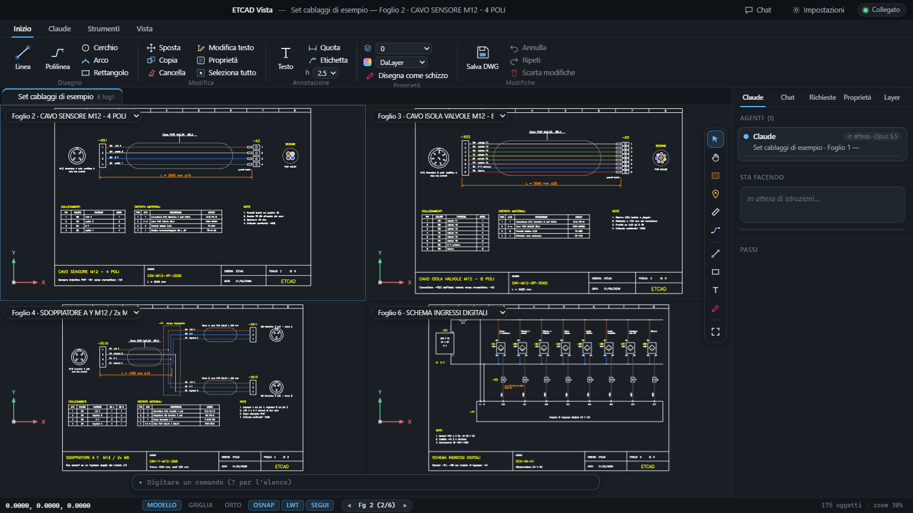<br><b>Several panes</b>: 1, 2 or 4 panes, one per sheet or one per agent.</td>
</tr>
<tr>
<td>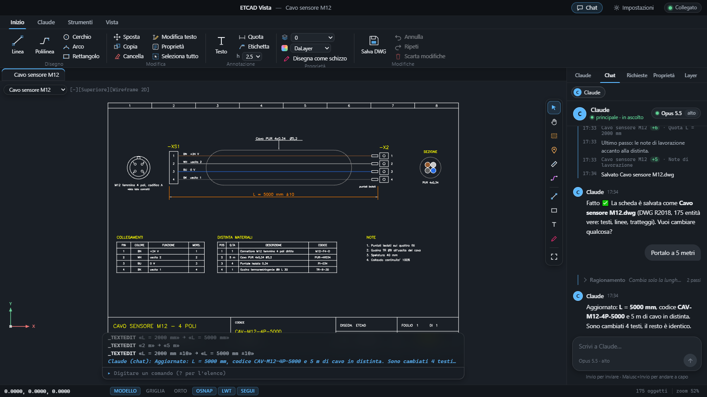<br><b>Chat like the Claude app</b>: markdown, collapsible reasoning, the model and effort of your Claude Code session.</td>
<td>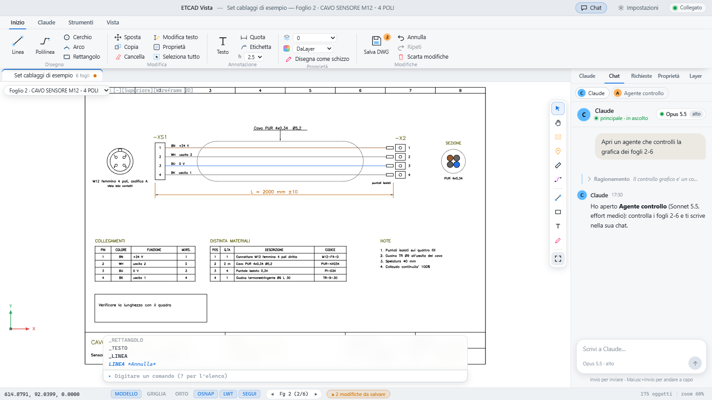<br><b>Light and dark themes</b>, PDF underlay, layers, properties with the DWG handle, measure, find.</td>
</tr>
</table>

Everything runs on `127.0.0.1`: no external service, no upload.

**Drawing commands** (type them in the command line, AutoCAD aliases work): `LINEA` (L), `POLILINEA` (PL),
`RETTANGOLO` (REC), `CERCHIO` (C), `ARCO` (A), `TESTO` (T, DT), `QUOTA` (DIM), `ETICHETTA` (LE), `SPOSTA` (M),
`COPIA` (CO), `CANCELLA` (E), `MODTESTO` (ED), `PROPRIETA` (PR), `ANNULLA` (U), `RIPETI`, `SALVA` (Ctrl+S),
`DISTANZA` (DI), `AREA`, `ID`, `FILO` (follow a wire), `TROVA` (Ctrl+F), `ZOOM`, `PAN`, `ORTO` (F8), `OSNAP` (F3),
`GRIGLIA` (F7).
**For Claude**: `CHIEDI` (select an area and ask), `NOTA` (a note on a point), `MATITA` and `NUVOLA` (sketch and
revision cloud), `CHAT`.

## PDF → DWG

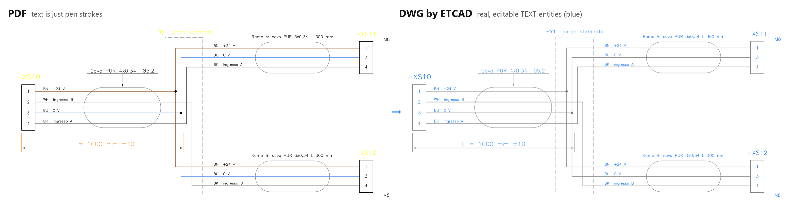

Many CAD programs plot SHX fonts as line segments, so a PDF of a drawing has no text at all. `pdf_a_dwg` groups the
strokes into characters, learns the glyphs of the document (a dictionary built with offline OCR), rebuilds spaces,
case, rotation and insertion points, finds the frame repeated on every page and turns it into a block with attributes.

On the example set in this repository (6 A3 sheets, generated with ETCAD and plotted to PDF), with no manual
correction: **505 of the 601 texts (84%) come back identical** and the pages overlay the PDF with a similarity of
0.96–0.98, in 30 seconds on an ordinary office PC. The rest is listed in the report for review and fixed with
`pdf_correggi`, which remembers the corrections for the next conversion.

## Examples

All the drawings in this repository are invented and generated from code ([`examples/genera_esempi.py`](examples/genera_esempi.py)).

<table>
<tr>
<td><a href="examples/set_cablaggi/anteprime/foglio_2.png">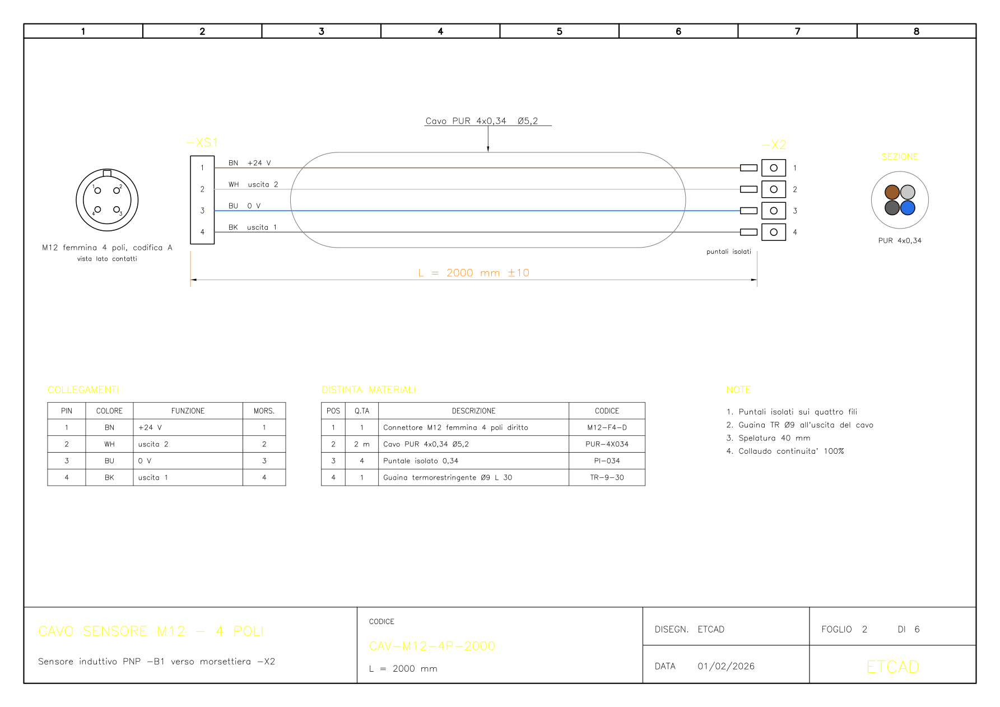</a><br>M12 4-pole sensor cable</td>
<td><a href="examples/set_cablaggi/anteprime/foglio_3.png">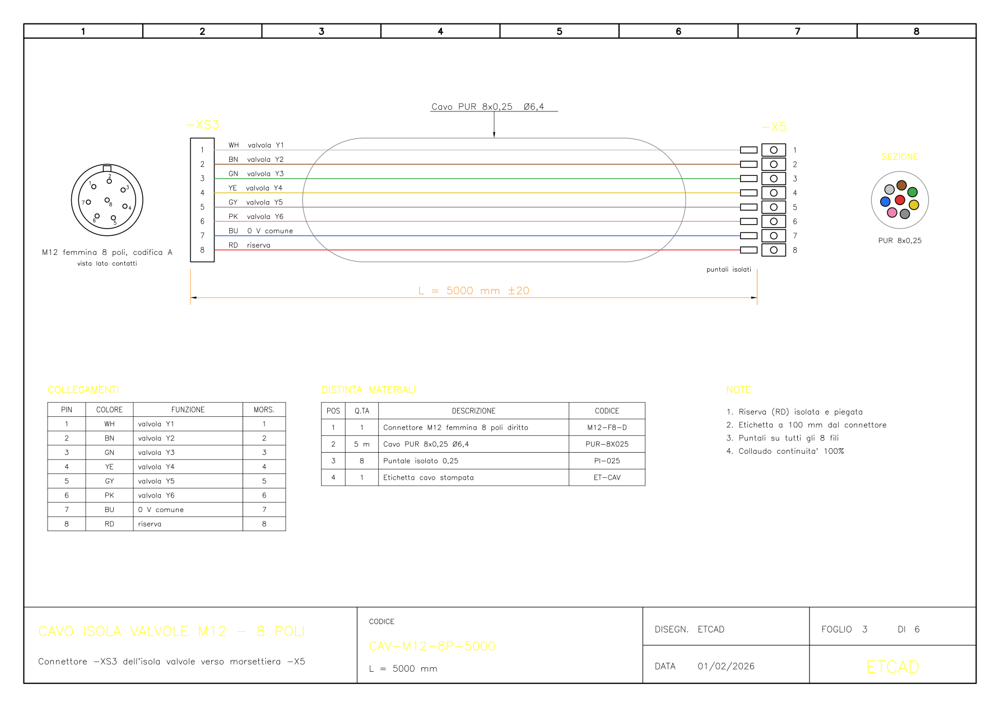</a><br>M12 8-pole valve island cable</td>
<td><a href="examples/set_cablaggi/anteprime/foglio_4.png">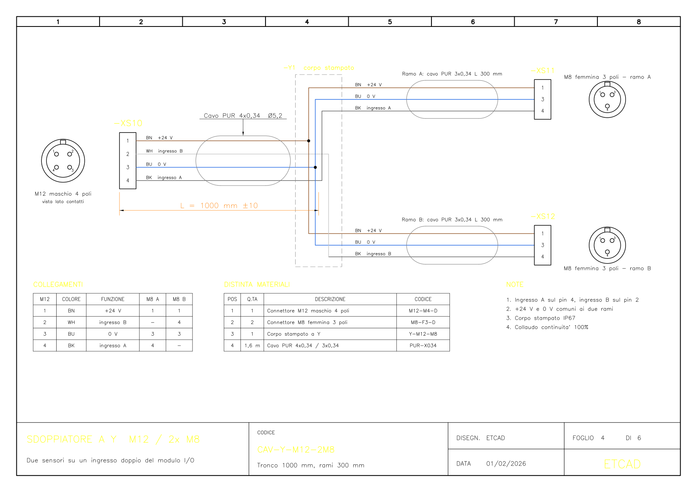</a><br>Y splitter M12 → 2× M8</td>
</tr>
<tr>
<td><a href="examples/set_cablaggi/anteprime/foglio_5.png">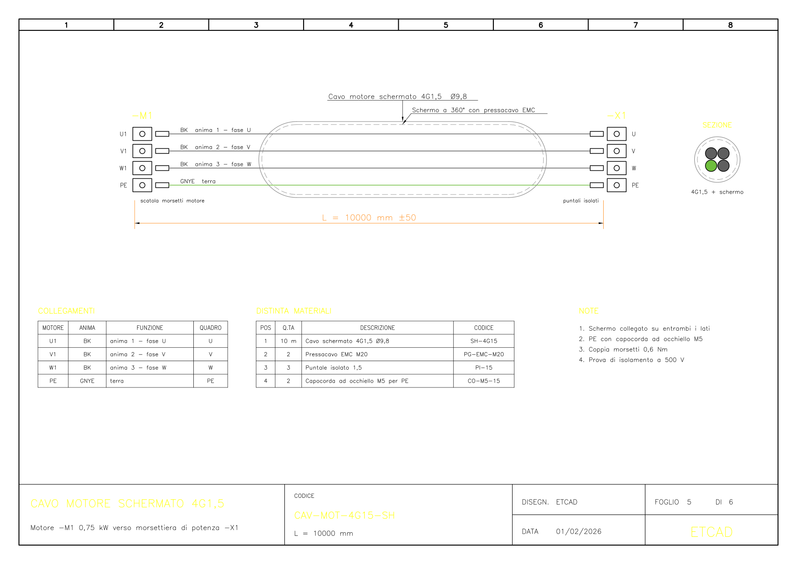</a><br>Shielded motor cable 4G1,5</td>
<td><a href="examples/set_cablaggi/anteprime/foglio_6.png">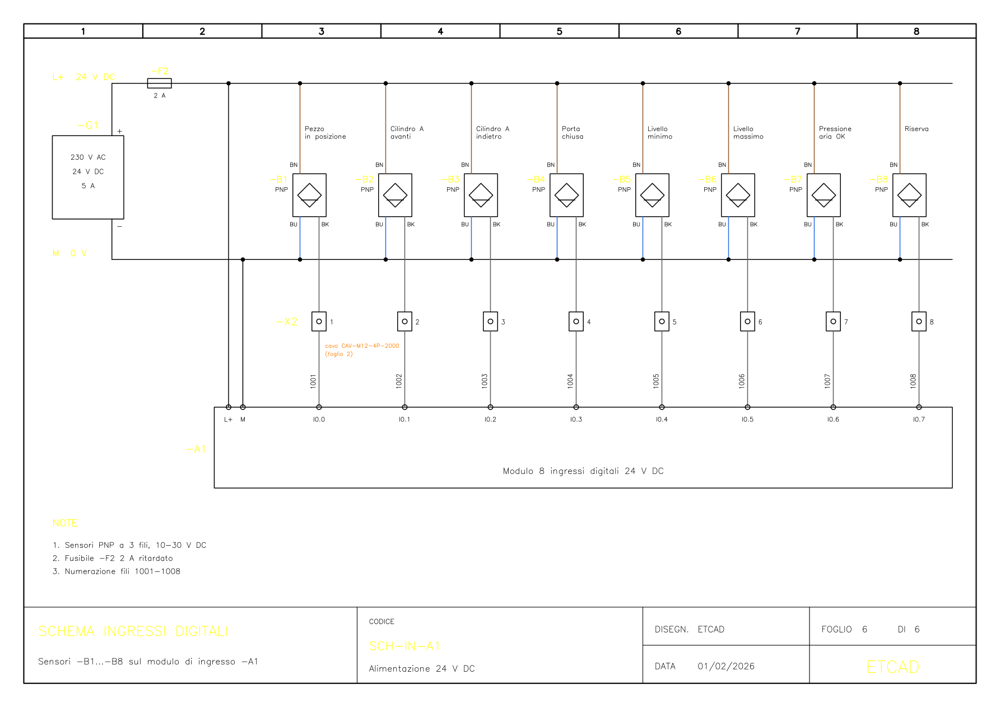</a><br>Digital inputs schematic (PLC)</td>
<td><a href="examples/set_cablaggi/anteprime/foglio_1.png">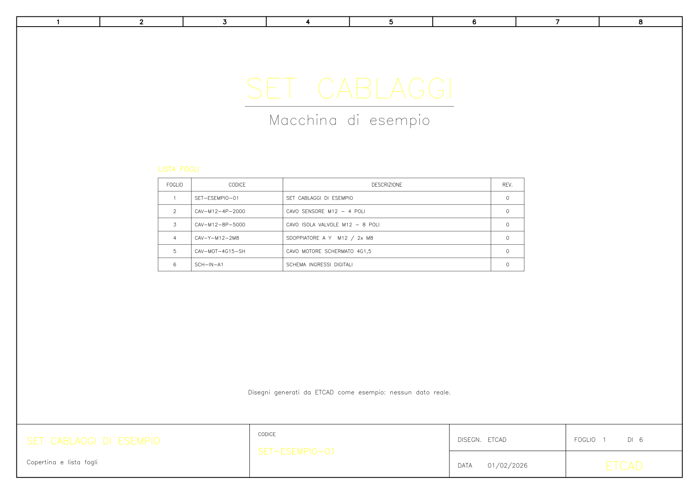</a><br>Cover and sheet list</td>
</tr>
</table>

- [`examples/set_cablaggi/`](examples/set_cablaggi): the 6 sheets in one DWG (frame as a block with attributes) and
  as a PDF, the input for trying PDF → DWG.
- [`examples/cavo_m12/`](examples/cavo_m12): the single sheet of the demo.
- [`examples/README.md`](examples/README.md): prompts to try with these files.

## Install

**Requirements**

- Python 3.11+ (or [uv](https://docs.astral.sh/uv/)).
- [ODA File Converter](https://www.opendesign.com/guestfiles/oda_file_converter) (free) to read and write DWG. ETCAD
  finds it in the usual folders, or set `ODA_FILE_CONVERTER` to the executable. Without it, ETCAD works on DXF.
- Optional: the `ocr` extra (RapidOCR, offline) for PDF → DWG.

**Claude Code**

```bash
claude mcp add etcad -- uvx --from git+https://github.com/Samuk734/ETCAD --with rapidocr_onnxruntime etcad
```

or with pip:

```bash
pip install "etcad[ocr] @ git+https://github.com/Samuk734/ETCAD"
claude mcp add etcad -- etcad
```

**Claude Desktop** (`claude_desktop_config.json`)

```json
{
  "mcpServers": {
    "etcad": {
      "command": "uvx",
      "args": ["--from", "git+https://github.com/Samuk734/ETCAD", "--with", "rapidocr_onnxruntime", "etcad"]
    }
  }
}
```

Check the setup by asking Claude to run `spac_status`: it reports the DWG converter, OCR and, if present, SPAC.

## Quick start

Ask Claude, for example:

- *"Open the live view and show me `examples/set_cablaggi/Set cablaggi di esempio.dwg`."*
- *"Convert `Set cablaggi di esempio.pdf` to DWG and tell me which texts you are not sure about."*
- *"On every sheet set the date in the title block to 01/03/2026 and the drafter to A.B."*
- *"Check sheet 4 for overlapping texts and fix them."*
- *"Follow the wire that starts at pin 3 of -XS1 and tell me where it ends."*
- *"Make the bill of materials of all the cable sheets in this folder, in Excel."*
- *"Open two agents: one checks sheets 2-3, the other sheets 4-6."*

### Working in the live view

1. Claude opens the page with `vista_apri` (or run `etcad-vista` yourself; it serves `http://127.0.0.1:8765`).
2. Every change Claude makes with the editing tools shows up animated on the sheet, with its reasoning.
3. To talk to Claude from the page, ask it to keep listening: it calls `vista_ascolta` in a loop (in Claude Code it
   can also run `etcad-vista ascolta --continuo` in the background). Your messages, selected areas and notes reach
   the session that is working, with no API key.
4. You can draw and edit on the sheet; **Salva DWG** writes your changes to a copy (`_modificato.dwg`) or over the
   file, with a backup.

A tip for your `CLAUDE.md`:

```markdown
When you work on DWG files with ETCAD, open the live view (vista_apri), send your reasoning with vista_pensa,
show every change with vista_mostra and keep vista_ascolta armed to read my messages from the page.
```

## All 66 tools

Tool names and descriptions are in Italian (the project was born in Italy); Claude understands them in any language.

<details>
<summary><b>Live view</b> (13)</summary>

| Tool | |
|---|---|
| `vista_apri` | Open the live view (local server and page) |
| `vista_mostra` | Show a DWG/DXF; if the sheet is already open, animate only the differences |
| `vista_osserva` | Watch a file or folder and reload when it changes on disk |
| `vista_pensa` | Write the current reasoning in the page |
| `vista_chat` | Write in the page chat, as Claude or as an agent |
| `vista_ascolta` | Wait for a message or a request from the page |
| `vista_richieste` | What you pointed at: areas, points, objects, sketches, with texts, handles and an image |
| `vista_rispondi` | Answer a request (shown under it and in the chat) |
| `vista_evidenzia` | Highlight an area for you, e.g. before asking a question |
| `vista_immagine` | PNG of a sheet or zone, as the page draws it |
| `vista_controlla` | Graphic check of an open sheet, results shown in the page |
| `vista_cerca` | Find texts in the open sheets |
| `vista_sfondo` | Put a PDF page under a sheet |

</details>

<details>
<summary><b>Read and preview</b> (7)</summary>

| Tool | |
|---|---|
| `dwg_info` | Layouts, entities by type, layers, blocks, styles |
| `dwg_entita` | Entities with handle, position and text, filterable |
| `dwg_anteprima` | Image of a DWG/DXF or of a zone in mm |
| `dwg_anteprima_pdf` | 1:1 vector PDF of a DWG, readable anywhere |
| `foglio_leggi` | Texts and symbols of one sheet of a multi-sheet drawing, with handles |
| `foglio_anteprima` | Image of one sheet |
| `dwg_collegamenti` | Excel data links and tables in a DWG |

</details>

<details>
<summary><b>Edit</b> (8)</summary>

| Tool | |
|---|---|
| `dwg_modifica` | Batch operations (JSON), native DWG output with backup |
| `dwg_modifica_testi` | Change texts and attributes by handle |
| `dwg_elimina` | Delete entities by handle |
| `dwg_layer` | Freeze, thaw or recolour a layer |
| `dwg_sostituisci` | Find & replace in a DWG or a folder |
| `dwg_cartiglio` | Read or set title-block attributes; remove a zone from the frame |
| `dwg_copia_zona` | Copy a zone into another drawing, with scale or frame-to-frame alignment |
| `dxf_a_dwg` | DXF → native DWG |

</details>

<details>
<summary><b>Check and analyse</b> (7)</summary>

| Tool | |
|---|---|
| `dwg_confronta` | Real differences between two DWGs or two folders: added, removed, changed texts, per layer |
| `dwg_controlla` | Overlapping texts, texts touched by lines, duplicates |
| `dwg_traccia_fili` | Follow a wire from a point |
| `dwg_posto_libero` | Where a new label fits without touching lines or texts |
| `testo_larghezza` | Width of a text in its font (SHX or TrueType) |
| `cablaggio_distinta` | Bill of materials from cable sheets, to Excel |
| `cartella_consegna` | Copy an output folder to its destination with MD5 checks, comparing DWGs by content |

</details>

<details>
<summary><b>PDF → DWG</b> (8)</summary>

| Tool | |
|---|---|
| `pdf_info` | Pages, sizes, producer, vector or raster, exploded text |
| `pdf_anteprima` | Image of a page or zone |
| `pdf_a_dwg` | Convert to DWG with real texts and a frame block |
| `pdf_testi` | The recognized texts, with id, position, height and confidence |
| `pdf_correggi` | Apply corrections and convert again (seconds) |
| `pdf_glifi` | The glyph dictionary, to label uncertain characters |
| `pdf_confronta` | Overlay of a PDF page and the converted DWG, with a similarity score |
| `pdf_confronta_pdf` | Overlay of two PDFs |

</details>

<details>
<summary><b>Electrical design helpers</b> (5)</summary>

| Tool | |
|---|---|
| `calcola_cavo` | Cable sizing: cross-section, ampacity, protection, voltage drop |
| `colori_filo` | Wire colour by function (EN 60204-1) |
| `progetta_foglio` | Draw a sheet from a JSON specification |
| `distinta_excel` | Excel bill of materials (components and cables) |
| `norms_check` | Data consistency checks (EN 60204-1, IEC 81346, EN 61439) |

</details>

<details>
<summary><b>SPAC Automazione CAD</b> (18, optional)</summary>

For projects made with SPAC Automazione CAD (an AutoCAD OEM). The database tools only read the project files; the
others need SPAC installed.

| Tool | |
|---|---|
| `spac_status` · `spac_diagnostica` | Installations, converters, OCR; timing of a headless run |
| `commessa_list` · `commessa_info` · `commessa_config` | Projects, their sheets and settings |
| `db_schema` · `db_query` · `db_coerenza` · `db_controlli` | The project database, read-only, and its checks |
| `fogli_list` · `multifoglio_scompatta` · `multifoglio_ricompatta` · `multifoglio_scompatta_dxf` | Multi-sheet drawings |
| `export_batch` · `dwg_plot_pdf` | Scripts and plots with `accoreconsole` |
| `live_invia_comando` · `live_apri_dwg` · `live_lisp` | Automation of a running SPAC through COM |

</details>

## Development

```bash
git clone https://github.com/Samuk734/ETCAD && cd ETCAD
pip install -e ".[ocr,dev]"
python -m pytest tests -q            # tests that need SPAC are skipped
python examples/genera_esempi.py     # regenerate the example drawings
python examples/video/registra_demo.py video   # re-record the demo (needs playwright and imageio-ffmpeg)
```

Developed and tested on Windows 10 with Python 3.12. The core (ezdxf, PyMuPDF, shapely) is cross-platform; the
SPAC and COM tools are Windows only. The live view's interface is in Italian.

## License

[MIT](LICENSE). The Hershey Roman Simplex font in `etcad/dati` is used for previews under the original Hershey terms.
